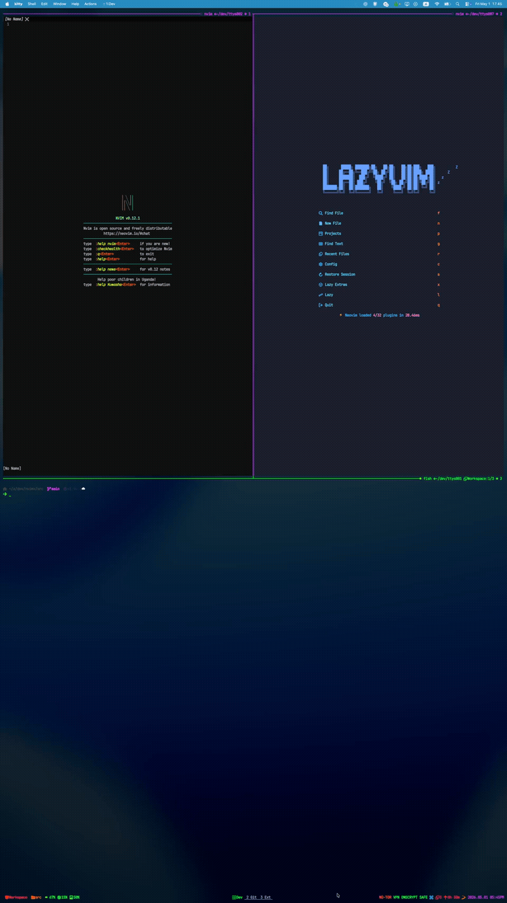

<p align="center">
  <a href="https://github.com/zx0r/nvimx/releases">
    
  </a>
  <a href="LICENSE">
    
  </a>
  <a href="https://www.rust-lang.org/">
    
  </a>
  <a href="https://neovim.io/">
    
  </a>
  <a href="https://specifications.freedesktop.org/basedir-spec/basedir-spec-latest.html">
    
  </a>
  <a href="https://news.ycombinator.com/">
    
  </a>
  <a href="https://reddit.com/r/unixporn">
    
  </a>
</p>

<p align="center">
  
</p>

<h2 align="center">
  Stop juggling configs → run Neovim side-by-side in isolation
</h2>


<p align="center">
  <a href="https://github.com/user-attachments/assets/c8e5853f-d98a-4951-aed8-1a8133172aa0">
    
  </a>
</p>

 
---

#### Quick Start

##### 1. Installation

```bash
# macOS / Linux (Homebrew)
brew install zx0r/tap/nvimx
```

```bash
# Rust Toolchain (Cargo)
cargo install nvimx
```

##### 2. Initialization & Shell Completions

```bash
# Initialize environment
nvimx init

# Shell completions
nvimx init fish | source   # Fish (~/.config/fish/config.fish)
eval "$(nvimx init zsh)"  # Zsh (~/.zshrc)
eval "$(nvimx init bash)" # Bash (~/.bashrc)
```

---

#### Overview

**It works as a transparent layer over Neovim:**

* no wrappers, patches, or feature limitations
* everything runs as if you launched nvim directly
* configs, plugins, LSPs, DAPs, and CLI flags behave exactly as usual

Each profile is completely independent, enabling reproducible and conflict-free setups

#### Features

* profile install from built-in preset (`.rodata`) or Git
* sandbox execution (ephemeral environments)
* shell completion

```bash
# Install from built-in preset (.rodata)
nvimx install lazyvim lazyvim

# Install from Git repository
nvimx install <repo-url> <profile-name>
```

---

#### Usage

```bash
# Launch Neovim with a profile
nvimx [PROFILE] [FILES...][-- ARGS...] 

# Manage profiles & environment
nvimx <COMMAND> [ARGS...] 

Arguments:
  [PROFILE]                      # Profile to run (defaults to configured profile)
  [FILES...]                     # Files to open
  [ARGS...]                      # Arguments passed to Neovim (after `--`)

EXAMPLES:
   nvimx                         # Launch with default profile
   nvimx list                    # List available profiles  
   nvimx lazyvim main.py         # Open main.py using the 'lazyvim' profile
   nvimx -- -c 'echo "hello"'    # Pass arguments directly to nvim
```

#### Commands

```bash
Commands:
  list, ls     List all locally installed profiles
  install      Install a new profile from a git repository or preset
  clean        Safely remove data, state, and cache for a profile
  init         Output shell completions for fish, zsh, or bash
  sandbox      Run a profile in an isolated environment

Shell completions:
  Fish: nvimx init fish | source
  Zsh:  eval "$(nvimx init zsh)"
  Bash: eval "$(nvimx init bash)"
```

---

#### Configuration

* strong defaults. zero-config
* if no profile is specified, an interactive picker (fzf) is used automatically

```bash
# Optional configuration file
cp config.example.toml ~/.config/nvimx/config.toml
```

```toml
# Default profile (skips fzf when set)
default_profile = "lazyvim"
```

#### Sandbox Mode

```shell
# The `sandbox` command executes a profile in a temporary environment
nvimx sandbox lazyvim
```

---

#### [ n v i m x ] 

<p align="center">
  
</p>


```shell
nvimx lazyvim --headless -c "lua print(vim.fn.stdpath('config'))" +qa

[✓] zero-overhead
[✓] isolated environment
[✓] argv passthrough

you bring args → we don't touch them  
you choose a profile → we don't leak state

that's it... happy coding...
```