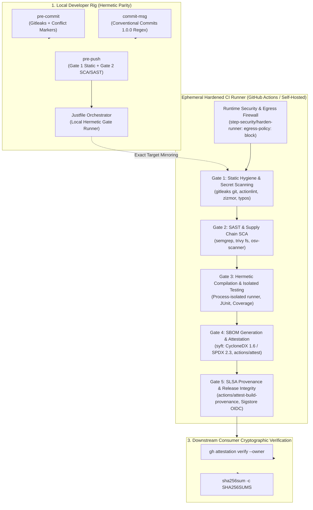

# CI/CD & DevSecOps Reference Architecture Standard (v2026.10)
## De Facto Industrial Specification: Shift-Left Gates, Hardened Workflows, Supply Chain Integrity & Local-to-CI Parity

**Classification:** Principal Systems Architecture & DevSecOps  
**Temporal Baseline:** October 2026 (10.2026)  
**Standard Compliance:** SLSA v1.1 Build Level 3, OpenSSF Scorecard L4, CycloneDX 1.6, SPDX 2.3, Sigstore Keyless OIDC / GitHub Artifact Attestations, Conventional Commits 1.0.0  
**Scope:** Polyglot / Language-Agnostic, Zero-Trust Execution, Local-to-CI Parity  
**Strict Invariant:** Zero corporate filler, zero marketing slogans. Pure engineering specifications, concrete models of threat, and verified configurations.

---

## 1. Threat Model & Architectural Invariants (10.2026)

Modern software supply chain attacks (e.g. SolarWinds, XZ-Utils, Shai-Hulud worm, Axios credential compromise, Codecov token exfiltration) exploit the CI/CD automation infrastructure rather than weaknesses in application logic. A Continuous Integration runner is an execution environment with access to privileged credentials (OIDC tokens, repository write tokens, container registry keys, signing identities).



### 1.1. Dominant CI/CD Attack Vectors
1. **Poisoned Pipeline Execution (PPE) & Context Injection:**  
   Unsanitized interpolation of GitHub context expressions (`${{ github.event.pull_request.title }}`, `${{ github.head_ref }}`) inside `run:` blocks. Allows an untrusted pull request author to execute arbitrary shell scripts (RCE) on the runner.
2. **`pwn-request` via `pull_request_target`:**  
   Triggering workflows with write permissions and secret access on incoming forks while checking out the fork's untrusted code (`ref: ${{ github.event.pull_request.head.sha }}`). Leads to instant secret exfiltration.
3. **Secret Exfiltration via Unrestricted Egress:**  
   Compromised third-party dependencies or malicious build scripts issuing outbound HTTP/DNS requests to transmit environment tokens (`GITHUB_TOKEN`, cloud credentials) to command-and-control (C2) servers. CI runners have unrestricted outbound Internet access by default.
4. **Credential Persistence Abuse (`artipacked`):**  
   `actions/checkout` stores the `GITHUB_TOKEN` in `.git/config` by default. Subsequent build steps or third-party actions can read this credential and push commits to protected branches.
5. **Upstream Tag Hijacking:**  
   Referencing third-party actions via mutable tags (e.g. `@v4`, `@main`). If a maintainer's account is compromised, the tag can be moved to point to malicious commit SHAs.

### 1.2. The Five DevSecOps Invariants
* **Invariant 1 (Zero-Trust Runner Egress):** All CI runner network egress is blocked at the Linux kernel level (via eBPF / auditd) by default (`egress-policy: block`). Outbound connections are restricted to explicit `host:port` allowlists.
* **Invariant 2 (Ephemeral & Credential-Less Execution):** `persist-credentials: false` is enforced across all checkout steps. Runners must never retain long-lived tokens in their git directories.
* **Invariant 3 (Cryptographic Immutability):** All external GitHub Actions are pinned to full 40-character commit SHAs with version annotations. All container images are pinned to `@sha256:...` digests.
* **Invariant 4 (Least-Privilege Token Matrix):** Default workflow permissions are explicitly declared as `permissions: {}` (or `contents: read`). Elevated scopes (`id-token: write`, `attestations: write`) are strictly isolated to individual leaf jobs.
* **Invariant 5 (Cryptographic Provenance):** All release binaries and SBOMs carry non-repudiable cryptographic attestations (SLSA v1.1 Build Level 3) issued via keyless Sigstore OIDC federation and verifiable via `gh attestation verify`.

---

## 2. De Facto Industrial Tooling Matrix (10.2026)

| Pipeline Domain | De Facto Standard Tool | Fallback / Alternative | Operational Role |
| :--- | :--- | :--- | :--- |
| **Local Task Runner** | `just` (v1.38+) | GNU `make` | High-performance, shell-agnostic command orchestrator with strict POSIX mode (`bash -euo pipefail`). |
| **Git Hooks Engine** | Native POSIX Shell (`.githooks/`) | `lefthook` (Go) | Zero-runtime, zero-dependency git hooks executing in < 15ms without Node (`husky`) or Python (`pre-commit`). |
| **Secret Scanning** | `gitleaks` (v8.24+) + `trufflehog` (v3.95+) | `trufflehog` CLI | Gitleaks for high-speed local/diff regex scanning; TruffleHog with `--results=verified` for live canary verification. |
| **Workflow Linter** | `actionlint` (v1.7.12+) | `yamllint` | AST syntax validation for GitHub Actions expressions and embedded ShellCheck verification of `run:` scripts. |
| **Workflow Security SAST**| `zizmor` (v1.31.1+, `zizmorcore`) | OpenSSF Scorecard | Rust-based AST analyzer detecting template injection (RCE), unpinned actions, `pwn-request`, and token leak paths. |
| **Exploitation Chains** | `poutine` (v1.1.6+, BoostSecurity) | — | CI/CD exploitation chain analysis modeling complete attack graphs from triggers (`pull_request_target`) to outputs. |
| **Application SAST** | `semgrep` (OSS Engine) | `codeql` | Language-agnostic structural AST pattern matching running fully offline (`SEMGREP_SEND_METRICS=off`). |
| **SCA & Vulnerability**| `trivy` (v0.60+) + `osv-scanner` (v2+) | `cargo-deny` (Rust) | Multi-ecosystem lockfile auditing against CVE, GHSA, and OSV.dev databases with CVSS/EPSS scoring. |
| **Runner Egress Hardening**| `step-security/harden-runner` (v2.20+) | Tetragon / Cilium (k8s) | Kernel-level eBPF monitoring blocking unauthorized outbound network egress and file tampering. |
| **Core Actions Suite** | `actions/checkout@v7`, `actions/upload-artifact@v7` | — | Node 24 runtime; hardware block on fork checkout under `pull_request_target` to prevent pwn-request exploits. |
| **SBOM Generation** | `syft` (v1.18+) | `trivy fs --format cyclonedx` | Deterministic generation of CycloneDX 1.6 JSON and SPDX 2.3 JSON dependency graphs. |
| **Build Attestation** | `actions/attest@v4` / `actions/attest-build-provenance` | `cosign` (Sigstore) | Keyless cryptographic signing of build provenance (SLSA v1.1) and SBOM via OIDC federation. |
| **Dependency Automation**| `renovate` (v39+) | `dependabot` | Automated dependency updates with global lockdown of post-upgrade execution vectors. |

---

## 3. Workflow Validation Architecture: Pre-Commit & CI Enforcement

### 3.1. Architectural Mandate: Should Workflows Be Validated Pre-Commit?
**YES, UNEQUIVOCALLY.**  
Treating the remote CI runner as a syntax/security debugger is a critical operational failure mode. Discovering an invalid YAML key, an unquoted shell variable, an unpinned action, or a template injection *after* pushing wastes queue capacity, runner minutes, and developer focus.

#### Multi-Tier Defense Model:
1. **Developer Workstation (Pre-Commit Hook):** Fast fail-closed validation (< 200ms) executed **only when files in `.github/` are staged**. Uses `actionlint -color` and `zizmor --offline` without network overhead.
2. **Local Orchestrator (`Justfile`):** `just lint-workflows` enables manual on-demand auditing across all workflow files before staging.
3. **Remote CI (Gate 0 Fast Gate):** Ephemeral execution on `ubuntu-24.04` running `actionlint`, `zizmor`, and `poutine` in parallel before spawning any build/test runners.

```
+-----------------------------------------------------------------------------------+
|                         3-LAYER WORKFLOW AUDIT SPECIFICATION                      |
+-------------------+--------------------+------------------------------------------+
| Layer             | De Facto Tool      | Scope & Enforcement                      |
+-------------------+--------------------+------------------------------------------+
| 1. Syntax & Shell | actionlint v1.7.12 | - Workflow syntax & YAML schema          |
|                   |                    | - Expression type checking (${{ ... }})   |
|                   |                    | - Embedded ShellCheck for run: scripts   |
+-------------------+--------------------+------------------------------------------+
| 2. Security SAST  | zizmor v1.31.1     | - Template Injection (RCE via PR title)  |
|                   |                    | - Unpinned actions (missing 40-char SHA) |
|                   |                    | - Excessive permissions (missing deny)   |
|                   |                    | - Artipacked (missing persist-cred: false)|
|                   |                    | - pwn-request (unsafe pull_request_target)|
+-------------------+--------------------+------------------------------------------+
| 3. Attack Chains  | poutine v1.1.6     | - Trigger-to-step exploitation pathways  |
|                   |                    | - Untrusted action creator verification  |
+-------------------+--------------------+------------------------------------------+
```

---

## 4. The 5-Gate Shift-Left CI Pipeline Specification

The pipeline is organized as a Directed Acyclic Graph (DAG) with strict execution boundaries:

```
                    +------------------------------------------+
                    |  Trigger: Git Push / PR / Merge Queue    |
                    +------------------------------------------+
                                         |
                                         v
                    +------------------------------------------+
                    | Gate 1: Static, Formatting & Secrets     | < 30s SLA (Fail-Fast)
                    | (zizmor, actionlint, Gitleaks, Linter)   |
                    +------------------------------------------+
                         |                                |
                         v                                v
    +-----------------------------+     +-------------------------------+
    | Gate 2: SAST & SCA          |     | Gate 3: Hermetic Build & Test | < 3m SLA
    | (semgrep, trivy,            |     | (Process Isolation, Nextest,  |
    |  osv-scanner, lockfile ban) |     |  Source Coverage >= 55%,      |
    +-----------------------------+     |  Sanitizers / Memory Safety)  |
                         \               /
                          v             v
                    +------------------------------------------+
                    | Gate 4: SBOM Generation & Attestation    | < 45s SLA
                    | (Syft: CycloneDX 1.6 + SPDX 2.3, Attest) |
                    +------------------------------------------+
                                         |
                                         v
                    +------------------------------------------+
                    | Gate 5: SLSA Provenance & Release Attest |
                    | (Sigstore OIDC, gh attestation, Cosign)  |
                    +------------------------------------------+
```

### Gate 1: Ephemeral Static Hygiene, Secrets & Workflow Validation
* **Target Execution Time:** `< 30 seconds`
* **Checks:**
  1. **Secret Scanning:** `gitleaks git` scanning commits and uncommitted staged diffs.
  2. **Workflow Syntax & ShellCheck:** `actionlint` parses YAML workflows and runs embedded shell scripts through `shellcheck`.
  3. **Workflow Security Rules:** `zizmor` audits all `.github/workflows/*.yml` for template injection (`${{ github.event.* }}`), unpinned actions, and excessive token grants.
  4. **Spelling & Identifier Integrity:** `typos` scans the codebase for common identifier errors.

### Gate 2: Static Application Security Testing (SAST) & Supply Chain (SCA)
* **Target Execution Time:** `< 60 seconds`
* **Checks:**
  1. **SAST:** `semgrep scan --config p/security-audit --config p/owasp-top-10 --error` checks source trees against security rules (OWASP Top 10, CWE-78 command injection, hardcoded credentials).
  2. **SCA:** `trivy fs --scanners vuln,misconfig --severity HIGH,CRITICAL --exit-code 1` inspects lockfiles (`Cargo.lock`, `package-lock.json`, `go.sum`, `poetry.lock`).
  3. **OSV Auditing:** `osv-scanner` checks transitive dependencies against Google's open vulnerability database.

### Gate 3: Hermetic Compilation & Isolated Testing
* **Target Execution Time:** `< 180 seconds` (matrix parallelized)
* **Checks:**
  1. **Hermetic Build:** Toolchains pinned via exact version files (`.tool-versions`, `rust-toolchain.toml`, `go.mod`).
  2. **CI Cache Optimization:** Dedicated, immutable cache keys. Incremental compilation disabled (`INCREMENTAL=0`) to eliminate cache bloat and race conditions.
  3. **Process-Isolated Test Harness:** Tests run in isolated child processes with process timeout bounds (`leak-timeout`, `slow-timeout`) to detect thread hangs and file descriptor leaks.
  4. **Artifacts:** Output structured JUnit XML reports (`target/reports/junit.xml`) and LCOV coverage data.

### Gate 4: SBOM Generation & Dynamic Verification
* **Target Execution Time:** `< 90 seconds`
* **Checks:**
  1. **SBOM Extraction:** `syft` analyzes project root and outputs standard `CycloneDX v1.6` and `SPDX v2.3` JSON graphs.
  2. **SBOM Cryptographic Attestation:** `actions/attest@v4` signs the SBOM using GitHub's Sigstore OIDC instance.
  3. **Dynamic Sanitizers (where applicable):** AddressSanitizer (ASan), MemorySanitizer (MSan), or Miri memory safety audits on critical paths.

### Gate 5: SLSA Level 3 Provenance & Release Integrity
* **Trigger:** Git Tag push (`refs/tags/v*.*.*`)
* **Checks:**
  1. **Hermetic Release Packaging:** Generate standalone tarballs/zip archives and calculate cryptographic SHA-256 digests into `SHA256SUMS`.
  2. **SLSA v1.1 Build Provenance:** `actions/attest-build-provenance` creates signed in-toto assertions linking the binary to the repository, commit SHA, and workflow identity.
  3. **Release Publishing:** Publish immutable release notes, assets, checksums, and SBOM.

---

## 4. Local-to-CI Parity: Canonical `Justfile`

The `Justfile` is the single source of truth for all build and verification targets. The CI workflow calls these exact recipes to guarantee 100% parity between developer workstations and remote runners.

```just
# ==============================================================================
# CANONICAL ZERO-TRUST JUSTFILE (POSIX & HERMETIC)
# Compatible with Linux, macOS, and POSIX-compliant execution environments
# ==============================================================================

set shell := ["bash", "-euo", "pipefail"]
set export := true

# Visual formatting tokens
C_RESET := "\\033[0m"
C_CYAN  := "\\033[36;1m"
C_GREEN := "\\033[32;1m"
C_RED   := "\\033[31;1m"

default:
    @just --list --unsorted

# ------------------------------------------------------------------------------
# 1. SETUP & TOOLCHAIN INITIALIZATION
# ------------------------------------------------------------------------------

# Link git hooks directly to .githooks without external runtimes
init-hooks:
    @printf "{{C_CYAN}}==> Configuring core.hooksPath to .githooks...{{C_RESET}}\n"
    @git config core.hooksPath .githooks
    @chmod +x .githooks/*
    @printf "{{C_GREEN}}Hooks configured successfully.{{C_RESET}}\n"

# Verify required security and build binaries exist in PATH
doctor:
    @printf "{{C_CYAN}}==> Checking toolchain binaries...{{C_RESET}}\n"
    @which git >/dev/null || (printf "{{C_RED}}Missing: git{{C_RESET}}\n" && exit 1)
    @which gitleaks >/dev/null || printf "{{C_RED}}Missing: gitleaks (brew install gitleaks || go install github.com/zricethezav/gitleaks/v8@latest){{C_RESET}}\n"
    @which semgrep >/dev/null || printf "{{C_RED}}Missing: semgrep (pip install semgrep || brew install semgrep){{C_RESET}}\n"
    @which trivy >/dev/null || printf "{{C_RED}}Missing: trivy (brew install trivy){{C_RESET}}\n"
    @which syft >/dev/null || printf "{{C_RED}}Missing: syft (brew install syft){{C_RESET}}\n"
    @which actionlint >/dev/null || printf "{{C_RED}}Missing: actionlint (brew install actionlint){{C_RESET}}\n"
    @which zizmor >/dev/null || printf "{{C_RED}}Missing: zizmor (cargo install zizmor || brew install zizmor){{C_RESET}}\n"

# ------------------------------------------------------------------------------
# 2. GATE 1: STATIC HYGIENE & SECRETS
# ------------------------------------------------------------------------------

gate-1: lint-fast secrets-detect workflow-audit
    @printf "{{C_GREEN}}==> [GATE 1 PASSED]: Static hygiene, secrets, and workflow schemas verified.{{C_RESET}}\n"

# Fast source linting and spell checking
lint-fast:
    @printf "{{C_CYAN}}==> [Gate 1] Executing fast static linter...{{C_RESET}}\n"
    @if command -v typos >/dev/null 2>&1; then typos .; else echo "Skip: typos (not installed)"; fi

# Secret detection on working tree
secrets-detect:
    @printf "{{C_CYAN}}==> [Gate 1] Running Gitleaks secret detection...{{C_RESET}}\n"
    @if command -v gitleaks >/dev/null 2>&1; then gitleaks git --verbose --redact; else echo "Skip: gitleaks (not installed)"; fi

# GitHub Actions workflow schema & security auditing
workflow-audit:
    @printf "{{C_CYAN}}==> [Gate 1] Linting workflows with actionlint & zizmor...{{C_RESET}}\n"
    @if command -v actionlint >/dev/null 2>&1; then actionlint -color; else echo "Skip: actionlint (not installed)"; fi
    @if command -v zizmor >/dev/null 2>&1; then zizmor --offline .github/workflows/; else echo "Skip: zizmor (not installed)"; fi

# Dedicated on-demand workflow validator
lint-workflows: workflow-audit

# ------------------------------------------------------------------------------
# 3. GATE 2: SAST & SUPPLY CHAIN (SCA)
# ------------------------------------------------------------------------------

gate-2: sast-scan sca-audit
    @printf "{{C_GREEN}}==> [GATE 2 PASSED]: SAST and Supply Chain vulnerabilities clear.{{C_RESET}}\n"

# Static Application Security Testing via Semgrep
sast-scan:
    @printf "{{C_CYAN}}==> [Gate 2] Executing Semgrep AST security rules...{{C_RESET}}\n"
    @if command -v semgrep >/dev/null 2>&1; then semgrep scan --config auto --error --quiet; else echo "Skip: semgrep"; fi

# Software Composition Analysis via Trivy
sca-audit:
    @printf "{{C_CYAN}}==> [Gate 2] Running Trivy dependency & misconfiguration audit...{{C_RESET}}\n"
    @if command -v trivy >/dev/null 2>&1; then trivy fs --scanners vuln,misconfig --severity HIGH,CRITICAL --exit-code 1 --config trivy.yaml .; else echo "Skip: trivy"; fi

# ------------------------------------------------------------------------------
# 4. GATE 3: HERMETIC BUILDS & TESTS
# ------------------------------------------------------------------------------

gate-3: test-isolated
    @printf "{{C_GREEN}}==> [GATE 3 PASSED]: Hermetic builds & process tests succeeded.{{C_RESET}}\n"

# Isolated test harness execution
test-isolated:
    @printf "{{C_CYAN}}==> [Gate 3] Executing isolated test suite...{{C_RESET}}\n"
    @mkdir -p target/reports
    # Project-specific isolated test command:
    # Rust:   cargo nextest run --profile ci --junit-path target/reports/junit.xml
    # Go:     gotestsum --junitfile target/reports/junit.xml -- -race ./...
    # Node:   vitest run --reporter=junit --outputFile=target/reports/junit.xml

# ------------------------------------------------------------------------------
# 5. GATE 4: SBOM GENERATION
# ------------------------------------------------------------------------------

gate-4: sbom-generate
    @printf "{{C_GREEN}}==> [GATE 4 PASSED]: SBOM artifacts generated.{{C_RESET}}\n"

# Generate CycloneDX and SPDX SBOMs via Syft
sbom-generate:
    @printf "{{C_CYAN}}==> [Gate 4] Generating SBOM via Syft...{{C_RESET}}\n"
    @mkdir -p dist/sbom
    @if command -v syft >/dev/null 2>&1; then \
        syft dir:. --exclude "./target" --exclude "./dist" --exclude "./.git" \
            -o cyclonedx-json@1.6=dist/sbom/bom.cdx.json \
            -o spdx-json@2.3=dist/sbom/bom.spdx.json; \
        printf "{{C_GREEN}}SBOM saved to dist/sbom/{{C_RESET}}\n"; \
    else \
        echo "Skip: syft (not installed)"; \
    fi

# ------------------------------------------------------------------------------
# 6. GATE 5: ARTIFACT DIGEST & RELEASE PACKAGING (LOCAL DRY-RUN)
# ------------------------------------------------------------------------------

gate-5:
    @printf "{{C_CYAN}}==> [Gate 5] Verifying distribution artifacts & calculating checksums...{{C_RESET}}\n"
    @test -d dist || (printf "{{C_RED}}Dist directory missing. Build artifacts first.{{C_RESET}}\n" && exit 1)
    @cd dist && find . -type f ! -name "*.sha256" ! -name "SHA256SUMS" -exec sha256sum {} + > SHA256SUMS
    @printf "{{C_GREEN}}==> [GATE 5 PASSED]: SHA256SUMS generated.{{C_RESET}}\n"

# ------------------------------------------------------------------------------
# MASTER PIPELINE: RUN ALL GATES LOCALLY
# ------------------------------------------------------------------------------

ci: gate-1 gate-2 gate-3 gate-4 gate-5
    @printf "{{C_GREEN}}================================================================{{C_RESET}}\n"
    @printf "{{C_GREEN}}  ALL 5 GATES VALIDATED: LOCAL WORKSPACE IDENTICAL TO CI PASS  {{C_RESET}}\n"
    @printf "{{C_GREEN}}================================================================{{C_RESET}}\n"
```

---

## 5. Hermetic Git Hooks Architecture (`.githooks/`)

No third-party runtime managers (no `husky`, `pre-commit` python, `overcommit`). All hooks are native POSIX sh scripts registered via `git config core.hooksPath .githooks`.

### 5.1. `.githooks/pre-commit`
```sh
#!/usr/bin/env sh
# ==============================================================================
# .githooks/pre-commit - Fast Fail-Safe Guard (< 100ms)
# ==============================================================================
set -eu

RED='\033[31;1m'
GREEN='\033[32;1m'
RESET='\033[0m'

printf "[Hook: pre-commit] Verifying staged contents...\n"

# 1. Prevent accidental commits containing merge conflict markers
if git diff --cached --name-only | xargs grep -E '^(<<<<<<<|=======|>>>>>>>)' 2>/dev/null; then
    printf "${RED}Error: Unresolved merge conflict markers detected in staged files!${RESET}\n"
    exit 1
fi

# 2. Prevent large binary commits (> 5 MB)
MAX_BYTES=5242880
for file in $(git diff --cached --name-only); do
    if [ -f "$file" ]; then
        FILE_SIZE=$(wc -c < "$file")
        if [ "$FILE_SIZE" -gt "$MAX_BYTES" ]; then
            printf "${RED}Error: File %s exceeds 5MB size limit (%d bytes). Blocked.${RESET}\n" "$file" "$FILE_SIZE"
            exit 1
        fi
    fi
done

# 3. Fast secret detection on staged modifications
if command -v gitleaks >/dev/null 2>&1; then
    gitleaks protect --staged --verbose --redact || {
        printf "${RED}Error: Gitleaks detected sensitive tokens/credentials in staged files!${RESET}\n"
        exit 1
    }
else
    printf "${RED}Warning: gitleaks not installed. Skipping local secret check.${RESET}\n"
fi

# 4. Workflow Syntax & Security SAST (Executes only when .github/ workflows are staged, < 200ms)
STAGED_WORKFLOWS=$(git diff --cached --name-only --diff-filter=ACM | grep -E '^\.github/(workflows/.*\.ya?ml|actions/.+/action\.ya?ml)$' || true)
if [ -n "$STAGED_WORKFLOWS" ]; then
    printf "${GREEN}[Hook: pre-commit] Staged GitHub Actions changes detected. Validating...${RESET}\n"
    if command -v actionlint >/dev/null 2>&1; then
        actionlint -color $STAGED_WORKFLOWS || exit 1
    fi
    if command -v zizmor >/dev/null 2>&1; then
        zizmor --offline $STAGED_WORKFLOWS || exit 1
    fi
fi

# 5. Fast source syntax check via Justfile
if command -v just >/dev/null 2>&1; then
    just lint-fast || exit 1
fi

printf "${GREEN}[Hook: pre-commit] Verification passed.${RESET}\n"
exit 0
```

### 5.2. `.githooks/commit-msg`
```sh
#!/usr/bin/env sh
# ==============================================================================
# .githooks/commit-msg - Conventional Commits 1.0.0 Validator (< 15ms)
# ==============================================================================
set -eu

COMMIT_MSG_FILE="$1"
FIRST_LINE=$(head -n 1 "$COMMIT_MSG_FILE")

# Allow automated git merges or reverts without inspection
if echo "$FIRST_LINE" | grep -Eq '^(Merge|Revert)[[:space:]]'; then
    exit 0
fi

# Strict Conventional Commits v1.0.0 regex:
# <type>(<scope>)!?: <description>
PATTERN="^(feat|fix|docs|style|refactor|perf|test|build|ci|chore|revert)(\([a-zA-Z0-9_\.-]+\))?!?: [a-zA-Z0-9].+"

if ! echo "$FIRST_LINE" | grep -Eq "$PATTERN"; then
    printf "\033[31;1m[Hook: commit-msg] Error: Commit message does not satisfy Conventional Commits 1.0.0!\033[0m\n"
    printf "Expected format:\n"
    printf "  <type>(<scope>): <subject>\n\n"
    printf "Permitted types:\n"
    printf "  feat, fix, docs, style, refactor, perf, test, build, ci, chore, revert\n\n"
    printf "Current commit message:\n  %s\n" "$FIRST_LINE"
    exit 1
fi

# Check Header Length <= 72 characters
HEADER_LEN=$(echo "$FIRST_LINE" | wc -c | tr -d ' ')
if [ "$HEADER_LEN" -gt 72 ]; then
    printf "\033[31;1m[Hook: commit-msg] Commit header exceeds 72 characters (Current: %d).\033[0m\n" "$HEADER_LEN"
    exit 1
fi
```

### 5.3. `.githooks/pre-push`
```sh
#!/usr/bin/env sh
# ==============================================================================
# .githooks/pre-push - Pre-Egress Quality Gate Verification
# ==============================================================================
set -eu

printf "\033[36;1m[Hook: pre-push] Executing Gate 1 & Gate 2 before upstream push...\033[0m\n"

if command -v just >/dev/null 2>&1; then
    just gate-1 || {
        printf "\033[31;1m[Hook: pre-push] Gate 1 failed. Push aborted.\033[0m\n"
        exit 1
    }
    just gate-2 || {
        printf "\033[31;1m[Hook: pre-push] Gate 2 (SAST/SCA) failed. Push aborted.\033[0m\n"
        exit 1
    }
else
    printf "\033[31;1mWarning: 'just' executable not found. Cannot run pre-push gates.\033[0m\n"
fi

printf "\033[32;1m[Hook: pre-push] Verification passed. Proceeding with push.\033[0m\n"
exit 0
```

---

## 6. Hardened Security Configurations

### 6.1. `.gitleaks.toml`
```toml
title = "Strict Secret Scanning Policy"

[extend]
useDefault = true

[allowlist]
description = "Global allowlist for synthetic test fixtures"
paths = [
    '''tests/fixtures/.*''',
    '''spec/.*''',
    '''Cargo\.lock$''',
    '''package-lock\.json$''',
    '''go\.sum$'''
]
regexes = [
    '''(?i)example[_-]?token''',
    '''(?i)mock[_-]?secret''',
    '''00000000-0000-0000-0000-000000000000'''
]
```

### 6.2. `trivy.yaml`
```yaml
timeout: 5m
cache:
  dir: ~/.cache/trivy

scan:
  scanners:
    - vuln
    - misconfig
    - secret

vulnerability:
  type:
    - os
    - library

severity:
  - HIGH
  - CRITICAL

exit-code: 1

misconfiguration:
  scanners:
    - dockerfile
    - terraform
    - kubernetes
```

### 6.3. `.zizmor.yml`
```yaml
rules:
  # Zero exceptions for critical injection and immutability rules
  template-injection:
    severity: error
  unpinned-uses:
    severity: error
  artipacked:
    severity: error
  pwn-request:
    severity: error

  excessive-permissions:
    ignore: []
```

---

## 7. Hardened GitHub Actions Workflows

### 7.1. `.github/workflows/ci.yml` (Gates 1 to 4 with Runtime Network Egress Control)

```yaml
name: CI Hermetic Pipeline

on:
  push:
    branches: [main]
  pull_request:
    branches: [main]

# Fail-closed default permissions across entire workflow
permissions: {}

concurrency:
  group: ${{ github.workflow }}-${{ github.ref }}
  cancel-in-progress: true

jobs:
  gate-1-static:
    name: "Gate 1: Static Hygiene, Secrets & Workflow SAST"
    runs-on: "ubuntu-24.04"
    timeout-minutes: 5
    permissions:
      contents: read
      security-events: write
    steps:
      - name: Harden Runner (Zero-Trust Egress Firewall)
        uses: step-security/harden-runner@bf7454d06d71f1098171f2acdf0cd4708d7b5920 # v2.20.0
        with:
          egress-policy: block
          allowed-endpoints: >
            api.github.com:443
            github.com:443
            objects.githubusercontent.com:443
            raw.githubusercontent.com:443

      - name: Checkout Source Code
        uses: actions/checkout@3d3c42e5aac5ba805825da76410c181273ba90b1 # v7.0.1
        with:
          fetch-depth: 0
          persist-credentials: false

      - name: Gitleaks Secret Detection
        uses: gitleaks/gitleaks-action@e30be9080766324d4554b73f8e5f1d8de431d044 # v2.3.7
        env:
          GITHUB_TOKEN: ${{ secrets.GITHUB_TOKEN }}

      - name: Install Tooling (actionlint & zizmor)
        uses: taiki-e/install-action@b73d9e8c460b2160d5b68ae41cb629598282e46b # v2.49.18
        with:
          tool: actionlint,zizmor

      - name: Actionlint Workflow Validation
        run: actionlint -color

      - name: Zizmor Workflow Security SAST
        uses: zizmorcore/zizmor-action@192e21d79ab29983730a13d1382995c2307fbcaa # v0.5.7
        with:
          version: "1.31.1"
          advanced-security: false

  gate-2-security:
    name: "Gate 2: SAST & Supply Chain Audit"
    needs: [gate-1-static]
    runs-on: "ubuntu-24.04"
    timeout-minutes: 10
    permissions:
      contents: read
      security-events: write
    steps:
      - name: Harden Runner
        uses: step-security/harden-runner@bf7454d06d71f1098171f2acdf0cd4708d7b5920 # v2.20.0
        with:
          egress-policy: block
          allowed-endpoints: >
            api.github.com:443
            api.osv.dev:443
            github.com:443
            objects.githubusercontent.com:443
            semgrep.dev:443

      - name: Checkout Source
        uses: actions/checkout@3d3c42e5aac5ba805825da76410c181273ba90b1 # v7.0.1
        with:
          persist-credentials: false

      - name: Semgrep SAST Scan
        uses: semgrep/semgrep-action@713efdd345f3035192eaa63f56867b88e63e4e5d # v1
        env:
          SEMGREP_SEND_METRICS: "off"
        with:
          config: p/security-audit,p/owasp-top-10
          auditOn: push

      - name: Trivy Supply Chain (SCA)
        uses: aquasecurity/trivy-action@18f2510ee396bbf400402947b394f2dd8c87dbb0 # 0.29.0
        with:
          scan-type: 'fs'
          scan-ref: '.'
          scanners: 'vuln,misconfig'
          severity: 'HIGH,CRITICAL'
          exit-code: '1'

  gate-3-test-matrix:
    name: "Gate 3: Build & Test Matrix"
    needs: [gate-2-security]
    strategy:
      fail-fast: false
      matrix:
        os: ["ubuntu-24.04", "macos-latest"]
    runs-on: ${{ matrix.os }}
    timeout-minutes: 20
    permissions:
      contents: read
    steps:
      - name: Checkout Source
        uses: actions/checkout@3d3c42e5aac5ba805825da76410c181273ba90b1 # v7.0.1
        with:
          persist-credentials: false

      - name: Install Just Runner
        uses: extractions/setup-just@dd310ad54e026804176733e24639490272b4ada7 # v2.0.0

      - name: Execute Isolated Test Suite
        run: just test-isolated

      - name: Upload Test Results
        if: always()
        uses: actions/upload-artifact@043fb46d1a93c77aae656e7c1c64a875d1fc6a0a # v7.0.1
        with:
          name: test-results-${{ matrix.os }}
          path: target/reports/

  gate-4-sbom-attest:
    name: "Gate 4: SBOM Generation & Attestation"
    needs: [gate-3-test-matrix]
    runs-on: "ubuntu-24.04"
    timeout-minutes: 10
    permissions:
      contents: read
      id-token: write
      attestations: write
    steps:
      - name: Checkout Source
        uses: actions/checkout@3d3c42e5aac5ba805825da76410c181273ba90b1 # v7.0.1
        with:
          persist-credentials: false

      - name: Generate CycloneDX & SPDX SBOMs
        uses: anchore/sbom-action@fc68e54721a364132470126a1005a63901b54a7c # v0.17.9
        with:
          path: '.'
          format: 'spdx-json'
          output-file: 'dist/sbom.spdx.json'

      - name: Attest SBOM Cryptographically
        uses: actions/attest@8ebeeb8008827a513e9a7e0427357488f831b402 # v4.1.0
        with:
          subject-path: 'dist/sbom.spdx.json'
          sbom-path: 'dist/sbom.spdx.json'
```

### 7.2. `.github/workflows/release.yml` (Gate 5: SLSA Level 3 & Cryptographic Provenance)

```yaml
name: Release & Supply Chain Integrity

on:
  push:
    tags:
      - 'v[0-9]+.[0-9]+.[0-9]+*'

permissions: {}

jobs:
  gate-5-release-provenance:
    name: "Gate 5: Build, Attest, and Provenance"
    runs-on: "ubuntu-24.04"
    timeout-minutes: 30
    permissions:
      contents: write
      id-token: write
      attestations: write
    steps:
      - name: Harden Runner
        uses: step-security/harden-runner@bf7454d06d71f1098171f2acdf0cd4708d7b5920 # v2.20.0
        with:
          egress-policy: block
          allowed-endpoints: >
            api.github.com:443
            github.com:443
            objects.githubusercontent.com:443
            fulcio.sigstore.dev:443
            rekor.sigstore.dev:443
            tuf-repo-cdn.sigstore.dev:443

      - name: Checkout Git Tag
        uses: actions/checkout@3d3c42e5aac5ba805825da76410c181273ba90b1 # v7.0.1
        with:
          persist-credentials: false

      - name: Install Just Runner
        uses: extractions/setup-just@dd310ad54e026804176733e24639490272b4ada7 # v2.0.0

      - name: Build Distribution Artifacts
        run: |
          mkdir -p dist
          tar -czf dist/artifact-${{ github.ref_name }}.tar.gz --exclude='.git' .
          cd dist && sha256sum * > SHA256SUMS

      - name: Attest Build Provenance (SLSA Level 3)
        uses: actions/attest-build-provenance@c074443f1a5fb4aee83904b08166100bc377de06 # v2.2.3
        with:
          subject-path: 'dist/artifact-${{ github.ref_name }}.tar.gz'

      - name: Generate Release SBOM
        uses: anchore/sbom-action@fc68e54721a364132470126a1005a63901b54a7c # v0.17.9
        with:
          path: '.'
          format: 'spdx-json'
          output-file: 'dist/sbom.spdx.json'

      - name: Attest Release SBOM
        uses: actions/attest@8ebeeb8008827a513e9a7e0427357488f831b402 # v4.1.0
        with:
          subject-path: 'dist/artifact-${{ github.ref_name }}.tar.gz'
          sbom-path: 'dist/sbom.spdx.json'

      - name: Publish GitHub Release
        uses: softprops/action-gh-release@c95fe1489396fe8a9ec87453c603b57748d95498 # v2.2.1
        with:
          files: |
            dist/artifact-${{ github.ref_name }}.tar.gz
            dist/SHA256SUMS
            dist/sbom.spdx.json
          generate_release_notes: true
```

---

## 8. Automated Dependency Management Security (Renovate Bot)

### 8.1. Threat Model: Remote Code Execution via `postUpgradeTasks`
* **Vulnerability:** Unrestricted command execution (`allowedCommands: [".*"]` or `allowedPostUpgradeCommands: ["bash -c .*"]`) allows any PR author or compromised dependency config to execute arbitrary shell scripts with the Renovate runner's privileges.
* **Blast Radius:** Exposure of `GITHUB_TOKEN` or GitHub App Installation Token, leading to repository exfiltration or unauthorized commits.
* **Mitigations (Strict Enforcements):**
  1. Never allow arbitrary shell commands in repository-level configurations (`allowedPostUpgradeCommands: []`).
  2. If tasks are required, pin specific deterministic commands and scope them to trusted branches only (`executionMode: "branch"`).
  3. Enforce a minimum release age (quarantine period of 3 days) for non-security updates to absorb typosquatting and account-takeover revocations.
  4. Scope GitHub App installation tokens to the exact repository.

### 8.2. Renovate Host Configuration (`config.js`)
```javascript
module.exports = {
  platform: 'github',
  gitAuthor: 'Renovate Bot <bot@security.domain.local>',
  
  // Mandatory: complete lock on post-upgrade commands at global level
  allowedPostUpgradeCommands: [],
  allowShellExecutorForPostUpgradeCommands: false,

  onboarding: true,
  onboardingConfig: {
    $schema: 'https://docs.renovatebot.com/renovate-schema.json',
    extends: ['config:recommended', ':pinAllExceptPeerDependencies'],
  },

  trustLevel: 'low',
  
  packageRules: [
    {
      matchManagers: ['github-actions'],
      pinDigests: true,
    },
  ],

  prConcurrentLimit: 10,
  prHourlyLimit: 2,
  rebaseWhen: 'conflicted',
};
```

---

## 9. Downstream Consumer Cryptographic Verification

A downstream consumer or automated production deployment validates artifacts using the official GitHub CLI (`gh`) and cryptographic digests without trusting the CI environment:

```bash
# 1. Verify SLSA Build Provenance against Sigstore Transparency Log
gh attestation verify artifact-v1.0.0.tar.gz --owner <organization-or-user>

# 2. Verify cryptographically signed Software Bill of Materials (SBOM)
gh attestation verify artifact-v1.0.0.tar.gz \
  --owner <organization-or-user> \
  --predicate-type https://spdx.dev/Document/v2.3

# 3. Verify exact SHA-256 binary hash
sha256sum -c SHA256SUMS
```
